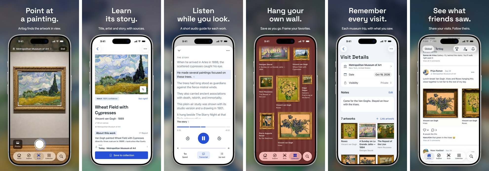

# Artlog

**Point your iPhone at a painting. Artlog tells you what it is and the story behind it, then
remembers your visit.**



Artlog is an iPhone app for museum visitors, built for the Nebius x NVIDIA Global AI Hackathon
(Best Apps and Agents track). It is open source under the [AGPL-3.0](LICENSE).

## Why

Wall labels are small, often crowded, and say little about the work. Audio guides cover a
handful of highlights and often cost extra. And the photos we take of paintings end up in the
camera roll with no name attached.

Artlog turns the phone you already carry into a guide for the painting in front of you. It
names the work, explains it with sources you can check, reads it aloud, and keeps a journal of
what you saw.

## What it does

- **Names the painting in about a second.** Point the camera at a painting to see its title,
  artist, date, medium and museum. Artlog recognizes about 400,000 artworks from open museum
  collections and Wikimedia Commons.
- **Tells its story, with sources.** "About this work" is three or four sentences, and each
  one links to where its fact came from, such as the museum's page, Wikipedia or Wikidata.
- **Plays an audio guide.** Tap Listen for a 40- to 90-second spoken guide, with a transcript
  to follow along.
- **Reads the wall label when it doesn't know the work.** Photograph the label and Artlog reads
  it, then checks it against the museum's records. Once you save the work, the next visitor gets
  an instant match.
- **Keeps a journal of your visits.** Saved works go into your collection and onto the visit
  where you found them. Add notes, and hang your favorites on your own wall.
- **Shares with friends, if you want.** Post a visit, follow friends, and see what they saw
  and want to see.
- **Shows what's on.** Explore lists museums near you and their current and upcoming
  exhibitions, read from each museum's own website and rechecked at least once a month.
- **Works without signal.** A scan taken offline waits on the phone and is identified when
  you're back online.
- **No account needed** to scan, save or contribute. Signing in with Apple or Google adds
  syncing between devices and sharing.

## How it works

1. **Recognize, on the phone.** NVIDIA's C-RADIOv3-B vision model runs on the iPhone and turns
   the painting into a compact fingerprint. The scan sends only that fingerprint, not the photo.
   Artlog compares the fingerprint with its catalog, double-checks the fine details, and then
   says it's a match, a possible match, or that it doesn't know.
2. **Read the label when needed.** Apple's on-device text recognition reads the wall label, and
   only the text is sent. NVIDIA Nemotron sorts the lines into title, artist, date and medium.
   Artlog confirms the result with the museum's records or Wikidata, and if that fails, searches
   the museum's own website with Tavily.
3. **Research the work once.** The first time anyone opens a painting, Tavily finds the museum's
   page and other sources, and Nemotron pulls out facts with quotes. A second Nemotron model
   writes the short story using only those facts. The result is saved for everyone after.
4. **Write and speak the audio guide.** When you tap Listen, Nemotron writes a short guide from
   the same research: what to look at, the strongest story, and a takeaway. Every sentence must
   point to the evidence it came from, and the backend checks that evidence word for word. An
   OpenAI voice reads the guide, and the player says the voice is AI-generated.
5. **Keep shared content clean.** Nemotron screens label text and contributions before they
   reach a screen or the shared catalog. Comments, visit reflections and bios are checked by
   OpenAI's moderation before others see them.
6. **Keep exhibitions current.** Every day, Artlog reads the exhibition pages of museums that are
   due for a check, skipping sites that ask not to be read. When a page only loads in a browser or
   comes back nearly empty, Tavily reads it instead. Nemotron lists each show's title, venue and
   dates, quoting the page, and Artlog keeps a show only if those quotes and dates are on the page.
   Pages that haven't changed since the last check never reach the model.

## Built with NVIDIA and Nebius

| What it does                                  | NVIDIA model                                                 | Where it runs                 |
| --------------------------------------------- | ------------------------------------------------------------ | ----------------------------- |
| Recognize the painting from the camera        | **C-RADIOv3-B**                                              | On the iPhone's Neural Engine |
| Sort wall-label text into fields              | **Nemotron 3 Super** (`nvidia/nemotron-3-super-120b-a12b`)   | Nebius Token Factory          |
| Pull cited facts from museum pages and others | **Nemotron 3 Super** (`nvidia/nemotron-3-super-120b-a12b`)   | Nebius Token Factory          |
| Write the short "About this work"             | **Nemotron 3.5 Lightning** (`nvidia/Nemotron-3_5-Lightning`) | Nebius Token Factory          |
| Write the audio guide                         | **Nemotron 3 Ultra** (`nvidia/Nemotron-3-Ultra-550b-a55b`)   | Nebius Token Factory          |
| Screen label text and contributions           | **Nemotron 3.5 Lightning** (`nvidia/Nemotron-3_5-Lightning`) | Nebius Token Factory          |
| List museums' current exhibitions             | **Nemotron 3 Super** (`nvidia/nemotron-3-super-120b-a12b`)   | Nebius Token Factory          |

C-RADIOv3-B takes about 67 ms per painting on an iPhone 16 Pro. The catalog's fingerprints were
made on a Mac with the same model weights the phone runs, and every catalog build is checked
against fingerprints taken on a real iPhone.

### Where Token Factory helped

- **The right model size for each job.** Token Factory serves every Nemotron size behind one
  OpenAI-compatible API. Artlog uses Ultra for the audio guide, the hardest writing job, Super
  for reading labels, research pages and exhibition listings, and Lightning for quick writing
  and screening. Moving a job to another model means changing one model ID.
- **Answers the app can check.** Strict JSON-schema output means every answer arrives in a fixed
  shape. Artlog drops any story sentence that doesn't cite a real fact and retries an audio guide
  whose evidence doesn't match the research.
- **Comparing models side by side.** The same test sets ran against several candidate models
  through one endpoint ([model comparisons](scripts/evals/token-factory/README.md)). On 25 real
  wall labels, Nemotron 3 Super got both title and artist right on 21. Two misses came from
  text-recognition errors and two from labels naming several artists.

Token Factory is the only Nebius service Artlog uses. Every model call goes through Artlog's
backend, never straight from the phone, with per-device limits and a daily call cap.

## Built with Tavily

Artlog's backend calls Tavily at runtime in three places:

- **Label check.** When the museum's records and Wikidata can't confirm a wall label, Artlog
  searches the museum's own website for the title and artist.
- **Research.** When a painting has no story yet, Tavily finds the museum's page about it and
  reads the reference pages its Wikidata record cites. Facts are quoted from those pages, with
  links back.
- **Exhibitions.** When a museum's exhibition page only loads in a browser or comes back nearly
  empty, Tavily reads it so Nemotron can list the shows. Sites that refuse to be read are
  skipped, not sent to Tavily.

Recognizing a painting doesn't depend on Tavily. A daily credit cap limits spending.

## Try it

**[Artlog on the App Store](https://apps.apple.com/app/id6815466893)**, free, iPhone only.

No museum nearby? On the Scan tab, tap **Photos** and pick a photo of a painting, such as one
from [The Met's open-access collection](https://www.metmuseum.org/art/collection).

## Run it yourself

You need a Mac with Xcode 27.1, Node 22.13 or newer, and an iPhone on iOS 17 or later. Scanning
needs the iPhone's camera.

1. Install Git LFS, which stores the recognition model:

   ```sh
   brew install git-lfs
   git lfs install
   ```

2. Download the code and its packages:

   ```sh
   git clone https://github.com/dwjiang/artlog-app.git
   cd artlog-app
   npm ci
   ```

3. Point the app at the hosted backend. Copy the example settings:

   ```sh
   cp .env.example .env.local
   ```

   Then set these two lines in `.env.local`:

   ```sh
   EXPO_PUBLIC_CONVEX_URL=https://admired-goldfinch-660.convex.cloud
   EXPO_PUBLIC_CONVEX_SITE_URL=https://admired-goldfinch-660.convex.site
   ```

4. Check that the model downloaded:

   ```sh
   npm run model:check
   ```

5. Connect your iPhone, then build and install the app:

   ```sh
   npx expo prebuild --platform ios --clean
   npx expo run:ios --device
   ```

Artlog has its own native code, so Expo Go can't run it. A copy you build and sign yourself can
scan and save. Apple lets only the official build add to the shared catalog (new works,
corrections and new museums), so use the App Store build for those. To run your own backend
or rebuild the catalog, see the [technical overview](docs/technical-overview.md).

## Privacy, in short

- **Scanning sends no photo.** A scan sends a fingerprint of about 20 KB that can't be turned
  back into a picture.
- **Wall-label photos stay on your phone.** Only the text is sent.
- **Location stays on your phone.** Artlog uses it to find the museum you're in and sends only
  the museum you pick. If no nearby museum is in its list, Apple's map search gets the area.
- **Sharing is small and reversible.** When you save a confirmed work, a crop of at most 256 px
  is shared so other visitors see a thumbnail. You can withdraw it in Settings.
- **Saved photos are backed up privately.** When you save a work, a smaller copy goes to Artlog's
  cloud so you can restore it. Camera and location data are removed first.
- **Crash reports leave out your content.** Reports from the released app go to Sentry with no
  photos, screenshots or locations.

The [technical overview](docs/technical-overview.md#privacy-details) has the full details.

## Data sources and terms

| Source                               | What Artlog uses                                                                                             | Terms                                                       |
| ------------------------------------ | ------------------------------------------------------------------------------------------------------------ | ----------------------------------------------------------- |
| The Met Open Access                  | Artwork records and images                                                                                   | CC0                                                         |
| Art Institute of Chicago             | Artwork records and gallery locations; descriptions quoted with a link                                       | CC0 records; descriptions CC BY 4.0                         |
| Cleveland Museum of Art Open Access  | Artwork records and images                                                                                   | CC0                                                         |
| Finnish National Gallery             | Artwork records and images from the Ateneum and Sinebrychoff                                                 | CC0                                                         |
| Wikidata and Wikimedia Commons       | Artwork records and images of public-domain works                                                            | Wikidata CC0; Commons per file, public-domain images only   |
| Wikipedia                            | Quoted in research, with links back                                                                          | CC BY-SA 4.0                                                |
| Museum websites and cited references | Read to confirm labels, research works and list exhibitions; quoted with links                               | Each site's own terms; museums can opt out                  |
| Images bundled in the app            | Onboarding examples, and profile pictures redrawn in crayon by OpenAI `gpt-image-2` from public-domain works | Public domain or CC0; each folder's `credits.md` lists them |

Museum images are used only to build the catalog and are deleted afterwards. The app shows
thumbnails from the museums' own sites rather than copies. WikiArt is not used, because its
license allows only non-commercial research. Nebius Token Factory, Tavily, OpenAI, Convex,
Cloudflare R2 and Pinecone are used under their API terms. The
[technical overview](docs/technical-overview.md#data-source-handling) describes how each source
is handled.

## License

Artlog is open source under the GNU Affero General Public License v3.0; see [LICENSE](LICENSE).
Notices for the open source libraries in the app are in Settings → About → Open source
licenses.

The bundled C-RADIOv3-B model is licensed separately under the
[NVIDIA Open Model License Agreement](modules/coreml-embed/ios/model-notices/c-radio-v3-b/nvidia-open-model-license.pdf).
The agreement and its required [Notice](modules/coreml-embed/ios/model-notices/c-radio-v3-b/Notice.txt)
ship with the app.

## For developers

- [Technical overview](docs/technical-overview.md): model details, architecture, running your
  own backend, rebuilding the catalog, and development commands
- [Documentation](docs/README.md): operations, findings and product contracts
- [Agent guide](AGENTS.md)
